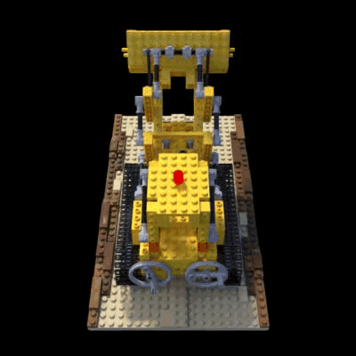

# radiance-fields
<p align="center">
  
</p>
A minimal, from-scratch implementation of NeRF and 3D Gaussian Splatting for view synthesis.

### **installation**
First install **PyTorch** appropriate for your system. Check your CUDA version with `nvidia-smi`, then:

```bash
# for cuda 12.6
uv pip install torch torchvision --index-url https://download.pytorch.org/whl/cu126

# for cuda 12.8
uv pip install torch torchvision --index-url https://download.pytorch.org/whl/cu128
```

Then install the rest of the dependencies:
```bash
uv sync --inexact && source .venv/bin/activate
```

### **dataset preparation**
This project uses the NeRF synthetic dataset from:
🔗 [https://www.matthewtancik.com/nerf](https://www.matthewtancik.com/nerf)

Place the scenes inside the `dataset/` directory, e.g.:

```
dataset/
└── lego/
    ├── images/
    ├── transforms_train.json
    ├── transforms_test.json
    └── transforms_val.json
```

`NeRFDataset` expects the standard `transforms_*.json` structure.

**train NeRF**

```bash
python train_nerf.py
```

**Evaluate a trained NeRF**

```bash
python evaluate_nerf.py
```
Outputs include PSNR metrics and rendered trajectories

### **gaussian splatting**
A pure PyTorch implementation of 3D Gaussian Splatting, including a differentiable tile-based rasterizer, spherical harmonics colors and adaptive density control (clone, split, prune).

**train**

```bash
python train_gs.py
```
Trains on `lego` at 400x400 and saves `checkpoints/gs_model.pt`. Resolution, iterations and densification schedule are set at the top of `train_gs.py`.

**evaluate**

```bash
python evaluate_gs.py
python scripts/convert_to_mp4.py eval_results_gs
```

### **results**
Mean PSNR over the 200 `lego` test views.

| method               | resolution | test PSNR |
|----------------------|------------|-----------|
| NeRF                 | 800x800    | 21.50 dB  |
| Gaussian Splatting   | 400x400    | 34.44 dB  |

The NeRF falls short of the ~32 dB reported in the paper, mainly because:
- there is no hierarchical sampling, only a single coarse network, while the paper adds a fine network that resamples 128 points along each ray where the coarse pass found density
- `evaluate_nerf.py` uses 32 samples per ray while `train_nerf.py` trains with 64
- training is much shorter, about 25k steps of 512 rays versus 100k-300k steps of 4096 rays in the paper

### **references**
- Mildenhall, Ben, Pratul P. Srinivasan, Matthew Tancik, Jonathan T. Barron, Ravi Ramamoorthi, and Ren Ng.
  **NeRF: Representing Scenes as Neural Radiance Fields for View Synthesis**.
  *European Conference on Computer Vision (ECCV)*, 2020.
  [https://arxiv.org/abs/2003.08934](https://arxiv.org/abs/2003.08934)
- Kerbl, Bernhard, Georgios Kopanas, Thomas Leimkühler, and George Drettakis.
  **3D Gaussian Splatting for Real-Time Radiance Field Rendering**.
  *ACM Transactions on Graphics (SIGGRAPH)*, 2023.
  [https://arxiv.org/abs/2308.04079](https://arxiv.org/abs/2308.04079)
